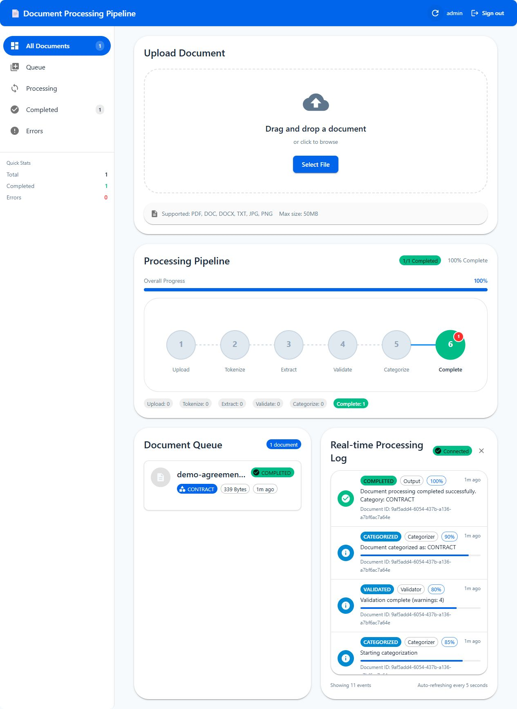
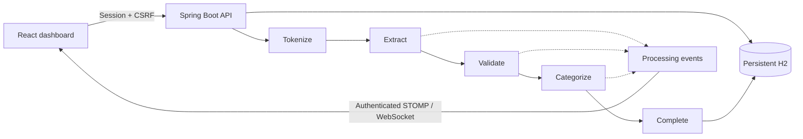

# Intelligent Document Processing Pipeline

[](https://github.com/saadh472/intelligent-document-processing-pipeline/actions/workflows/quality.yml)

A full-stack document workflow built with **Java 17, Spring Boot 3.5, React, and TypeScript**. Sign in to a private workspace, upload a document, run the processing stages, and inspect the extracted text, category, and live progress events. Uploaded content and processing results persist across application restarts.



**[Five-minute walkthrough](docs/WALKTHROUGH.md)** · **[Fictional sample document](examples/demo-agreement.txt)** · **[Security](SECURITY.md)** · **[License](LICENSE)**

## What it demonstrates

- A React dashboard with an authenticated upload queue, stage visualization, and STOMP/WebSocket processing updates.
- A Spring Boot API protected by cookie sessions and CSRF tokens. Sign-in rotates the session ID and token; logout closes live subscriptions.
- File-backed H2 storage for uploaded bytes, extracted text, document status, and categories. Flyway manages the schema and Hibernate validates it at startup.
- Apache Tika text parsing, extraction strategies, chained validation, and keyword-based document categorization.
- Integration checks covering TXT, PDF, and DOCX processing, authenticated HTTP requests, rejected CSRF requests, live events, logout, and a real database close/reopen cycle.

This is a portfolio and coursework application. Its classification is **rule-based**, with no trained machine-learning model or legal accuracy guarantee. Image-only documents require additional OCR configuration. Kafka is optional and disabled in the verified local workflow.

## Run locally

Install **JDK 17**, **Maven 3.9+**, and **Node.js 24**. On Windows, double-click [Start Pipeline.cmd](Start%20Pipeline.cmd). The launcher builds the API, installs missing frontend dependencies, starts both services, and prints the dashboard URL, credential file path, and temporary log directory. Keep its window open while using the application.

For manual startup, use two terminals from the repository root:

```sh
# Terminal 1
cd backend
mvn spring-boot:run
```

```sh
# Terminal 2
cd frontend
npm ci
npm start
```

Open [the dashboard](http://127.0.0.1:3000). The backend binds to loopback on port `8080`; [its public health endpoint](http://127.0.0.1:8080/api/health) is available before sign-in. The frontend uses its development proxy for `/api` and `/ws`; the Windows launcher supplies explicit loopback URLs and also supports a custom backend port.

### Sign in

The default username is **`admin`**. On first launch, the API generates a random password and writes it to **`backend/data/bootstrap-password.txt`** when started using the commands above or the launcher. Read that file locally; it is ignored by Git. The app reuses the generated password on subsequent launches.

For externally managed credentials, set `IDP_USERNAME` and `IDP_PASSWORD` before starting the backend. Passwords must contain at least 12 characters. There is one configured workspace account, with access to the workspace's documents; registration, separate user workspaces, password recovery, and role administration are outside this implementation. Login sessions expire after 30 minutes of inactivity and do not survive backend restarts.

### Configuration

| Variable | Default / behavior |
| --- | --- |
| `IDP_USERNAME` | `admin` |
| `IDP_PASSWORD` | Unset: generate/reuse the local bootstrap password file. |
| `IDP_DATA_DIR` | `./data`, relative to the backend process working directory. Contains the default database and generated password. |
| `IDP_DATABASE_URL` | File H2 database under `IDP_DATA_DIR`; can be set to a PostgreSQL JDBC URL. |
| `IDP_DATABASE_USERNAME` / `IDP_DATABASE_PASSWORD` | `sa` / generated private local secret for new H2 databases; set both for an external database. |
| `IDP_ALLOWED_ORIGINS` | `http://localhost:3000,http://127.0.0.1:3000`; comma-separated exact frontend origins. |
| `SESSION_COOKIE_SECURE` | `false` for local HTTP. Set `true` when serving through HTTPS. |
| `SERVER_ADDRESS` | `127.0.0.1`; the container image binds internally to `0.0.0.0`. |

Environment variables are read by the backend directly. A root `.env` file is used by Docker Compose, and is not automatically loaded by Maven or the Windows launcher.

### Docker Compose

```sh
docker compose up --build
```

Open [the dashboard](http://127.0.0.1:3000). Both published ports bind to loopback. A named `pipeline-data` volume persists the H2 database and generated password. To read that generated password locally:

```sh
docker compose exec backend cat /app/data/bootstrap-password.txt
```

Alternatively, supply `IDP_PASSWORD` through your environment or an ignored `.env` file; [.env.example](.env.example) documents the optional settings without shipping a shared password. `docker compose down` preserves the named volume. Removing the volume removes its documents and generated credentials. The Compose configuration is provided for local use; Docker execution was not verified in the current Windows environment.

## Try the workflow

Sign in, upload [examples/demo-agreement.txt](examples/demo-agreement.txt), and choose **Start Pipeline**. The file should reach `COMPLETED` with category `CONTRACT`. Multiple queued files are processed in order. The [walkthrough](docs/WALKTHROUGH.md) explains the expected screens and a restart check.

Accepted extensions: **PDF, DOC, DOCX, TXT, JPG, JPEG, and PNG**, up to **50 MB per file**. Use fictional files. Text-containing PDF and DOCX examples are covered by tests; scanned documents need an OCR setup beyond the default installation.

## Architecture



| Pattern | Implementation |
| --- | --- |
| Pipes and Filters | [Pipeline stages](backend/src/main/java/com/legal/documentprocessing/pipeline) pass a document through sequential transformations. |
| Strategy | The [extraction factory](backend/src/main/java/com/legal/documentprocessing/strategy/ExtractionStrategyFactory.java) selects an extractor by file type. |
| Chain of Responsibility | The [validation chain](backend/src/main/java/com/legal/documentprocessing/validation/ValidationChainBuilder.java) checks format, content, and legal terms. |
| Observer | [Processing observers](backend/src/main/java/com/legal/documentprocessing/observer) log events and publish dashboard updates. |
| Composite | The [structure builder](backend/src/main/java/com/legal/documentprocessing/composite/DocumentStructureBuilder.java) models sections, paragraphs, and metadata. |

## API

Use the session cookie and current `X-CSRF-TOKEN` header for state-changing requests. Anonymous access to document APIs returns `401`; absent or invalid CSRF tokens return `403`. The WebSocket handshake requires authentication, permits configured origins, and accepts read-only processing subscriptions.

| Method and route | Behavior |
| --- | --- |
| `GET /api/health` | Public liveness response. |
| `GET /api/auth/session` | Session state and CSRF token; available before login. |
| `POST /api/auth/login` | JSON `{ "username": "…", "password": "…" }`; returns authenticated session state and a rotated token. |
| `POST /api/auth/logout` | Invalidate the login session and close its live subscriptions; returns an anonymous session token. |
| `POST /api/documents/upload` | Multipart upload with field `file`; returns metadata without raw file bytes. |
| `GET /api/documents` | List document summaries. |
| `GET /api/documents/{id}` | Document details, current state, and extracted text. |
| `POST /api/documents/{id}/process` | Process an uploaded document. |
| `GET /api/documents/{id}/structure` | Document hierarchy. |
| `GET /api/documents/status/{status}` | Filter by pipeline status. |
| `GET /api/documents/category/{category}` | Filter by rule-assigned category. |

### Cookie and CSRF example

The following uses Bash, `curl`, and `jq` with a running local API. Read the password from the local bootstrap file or your configured secret; the prompt avoids placing it directly in shell history. Keep the temporary cookie file private.

```bash
API=http://127.0.0.1:8080/api
umask 077
COOKIE_DIR=$(mktemp -d)
COOKIES="$COOKIE_DIR/session.txt"
CSRF=$(curl --fail --silent --cookie-jar "$COOKIES" "$API/auth/session" | jq -r .csrfToken)
read -r -s -p 'Workspace password: ' IDP_PASSWORD
printf '\n'
LOGIN=$(printf '%s' "$IDP_PASSWORD" | jq -Rs --arg username admin '{username:$username,password:.}' |
  curl --fail --silent --cookie "$COOKIES" --cookie-jar "$COOKIES" \
    --header "X-CSRF-TOKEN: $CSRF" --header 'Content-Type: application/json' \
    --data-binary @- "$API/auth/login")
unset IDP_PASSWORD
CSRF=$(printf '%s' "$LOGIN" | jq -r .csrfToken)
curl --fail --cookie "$COOKIES" --header "X-CSRF-TOKEN: $CSRF" \
  --form file=@examples/demo-agreement.txt "$API/documents/upload"
curl --fail --cookie "$COOKIES" "$API/documents"
curl --fail --cookie "$COOKIES" --header "X-CSRF-TOKEN: $CSRF" \
  --request POST "$API/auth/logout"
```

Run this example from the repository root; change `--arg username admin` if you configured another username. After logout, discard the temporary cookie file. Obtain a fresh session/token before another login; do not replay rejected uploads or processing actions automatically.

## Storage and backups

For the default local setup, documents are stored in `backend/data/documents.mv.db`. The database contains the uploaded bytes and extracted content. Terminal document states and categories persist; transient WebSocket stage messages are not an audit log. Stop the backend before copying the data directory to a private backup location, and keep the original intact until you have verified the restore. Restore while the backend is stopped, using a compatible app version and the same data directory.

The generated workspace password and database credential are local sensitive data. New local H2 installations generate a separate random secret in `backend/data/database-password.txt`; startup reuses it to open the database. This authenticates database connections; it does not encrypt the database file. Back up the full data folder, including both credential files. Losing the database credential can prevent reopening the saved documents. Keep data folders and backups outside source control; `.gitignore` excludes the default locations and credential files. For containers, back up the named volume while the backend is stopped. Flyway applies tracked schema migrations and Hibernate validates the resulting schema; startup does not recreate or drop the document table.

### Existing passwordless H2 databases

Earlier local builds used an empty H2 database password. The new secure default does not open or overwrite those files automatically. To continue using such an existing local database temporarily, set `IDP_ALLOW_LEGACY_H2_PASSWORDLESS=true` before startup and keep the backend bound to loopback. This compatibility setting is only for an existing passwordless H2 database, not a public deployment. To keep its documents while upgrading, stop the application, back up the data directory, and use H2's administration tools to set a nonempty password; then configure that same value through `IDP_DATABASE_PASSWORD` and remove the compatibility setting. Set the database password before switching credentials; changing an environment variable does not change the database's stored password.

The backend includes a PostgreSQL driver, Flyway's PostgreSQL module, and portable document column mappings. To use a dedicated database, set `IDP_DATABASE_URL` to `jdbc:postgresql://HOST:5432/DATABASE` and configure its username/password. **PostgreSQL execution and migration were not integration-tested in this environment**; the verified persistence path is file H2. The supplied Compose file uses H2.

## Verification

Run from the repository root:

```sh
mvn --batch-mode -f backend/pom.xml verify
cd frontend
npm ci
npm run typecheck
npm test -- --watchAll=false --runInBand
npm run build
```

The backend suite includes a real HTTP/STOMP test that signs in, checks CSRF/session rotation, uploads and processes a fictional contract, verifies logout closes the subscription, then restarts the server against the same file database and verifies the record remains. Other tests cover TXT, PDF, DOCX, and unsupported uploads. Frontend tests cover authentication, request handling, connection lifecycle, and the pipeline interface.

The Windows launcher can also verify that both services start, then stop its own child processes:

```powershell
powershell -NoProfile -ExecutionPolicy RemoteSigned -File .\launchers\start-local.ps1 -CheckOnly -NoBrowser
```

## Security, limitations, and reuse

This application provides a single private workspace. Before exposing it to the internet, configure HTTPS and secure cookies, exact frontend origins, externally managed secrets, backups, upload retention, and operational monitoring. It does not provide malware scanning, organization-level authorization, durable event auditing, or legal advice. See [SECURITY.md](SECURITY.md) for the supported scope and reporting guidance.

The project code is available under the [MIT License](LICENSE). Preserve existing notices when reusing it; dependency and third-party acknowledgements are recorded in [THIRD_PARTY_NOTICES.md](THIRD_PARTY_NOTICES.md).
