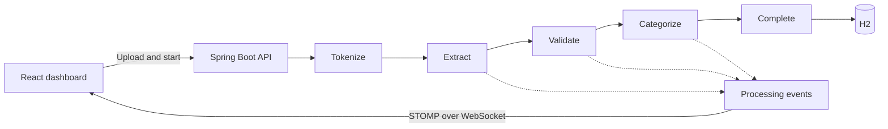

# Intelligent Document Processing Pipeline

[](https://github.com/saadh472/intelligent-document-processing-pipeline/actions/workflows/quality.yml)

A prototype for processing documents such as contracts, motions, and correspondence. The React and TypeScript dashboard accepts uploads, queues documents for processing, and shows status, category, and progress events from the Spring Boot API.

## Quick start

Install Java 17, Maven 3.9, and Node.js 24. On Windows, double-click [Start Pipeline.cmd](Start%20Pipeline.cmd). It builds the backend, starts both services, and opens the dashboard when it is ready. Keep the launcher window open while using the app. It writes startup logs to a temporary folder and prints that folder's path.

For manual startup, run the backend and frontend in separate terminals from the repository root.

**Backend**

```sh
mvn -f backend/pom.xml spring-boot:run
```

**Frontend**

```sh
cd frontend
npm ci
npm start
```

Open the [dashboard](http://localhost:3000). The API listens on port `8080`. The local demo uses an in-memory H2 database and processes each document when you start the pipeline from the dashboard.

The repository also includes a Docker Compose configuration for the same local demo. With Docker installed, run `docker compose up --build` from the repository root and open the dashboard at the same address.

## Try the pipeline

Save this fictional example as `demo-agreement.txt`.

```text
Demo Supply Agreement

On 04/15/2025, the parties signed this contract for delivery of sample office supplies.
The agreement records the terms and conditions for the demonstration order.
```

1. Upload the file in **Upload Document**.
2. Select **Start Pipeline (1)** in the **Processing Pipeline** panel. If several documents are queued, the button processes that queue in order and reports the result for each file.
3. Check the document card for `COMPLETED` and `CONTRACT`, and review the stage events in **Real-time Processing Log**.

The upload control accepts PDF, DOC, DOCX, TXT, JPEG, and PNG files. The plain text example exercises the default local flow without requiring an OCR setup.

## How it works

Apache Tika reads text from uploaded files. The pipeline runs extraction and validation rules before assigning a category based on keywords.



| Pattern | Implementation |
| --- | --- |
| Pipes and Filters | [Pipeline stages](backend/src/main/java/com/legal/documentprocessing/pipeline) receive a document and pass it to the next stage. |
| Strategy | The [extraction factory](backend/src/main/java/com/legal/documentprocessing/strategy/ExtractionStrategyFactory.java) selects an extractor based on the file type. |
| Chain of Responsibility | The [validation chain](backend/src/main/java/com/legal/documentprocessing/validation/ValidationChainBuilder.java) runs format, content, and legal-term checks. |
| Observer | [Processing observers](backend/src/main/java/com/legal/documentprocessing/observer) log events and publish them to the dashboard. |
| Composite | The [structure builder](backend/src/main/java/com/legal/documentprocessing/composite/DocumentStructureBuilder.java) represents a document as a tree of sections, paragraphs, and metadata. |

## API

| Method and route | Behavior |
| --- | --- |
| `POST /api/documents/upload` | Upload a multipart file using the `file` field. |
| `GET /api/documents` | List documents. |
| `GET /api/documents/{id}` | Get a document and its current status. |
| `POST /api/documents/{id}/process` | Run the pipeline on an uploaded document. |
| `GET /api/documents/{id}/structure` | Return the document’s hierarchy. |
| `GET /api/documents/status/{status}` | Filter documents by pipeline status. |
| `GET /api/documents/category/{category}` | Filter documents by predicted category. |

## Verification

From the repository root, run the backend checks and build the frontend bundle.

```sh
mvn -f backend/pom.xml verify
cd frontend
npm ci
npm run typecheck
npm test -- --watchAll=false --runInBand
npm run build
```

## Demo scope

Use fictional or public sample documents. The local demo has no sign-in and keeps uploaded files and processing results in memory until the backend stops. Extraction and categorization are rule-based, and validation warnings are for demonstration. Image-only and scanned documents require a separate OCR setup.
