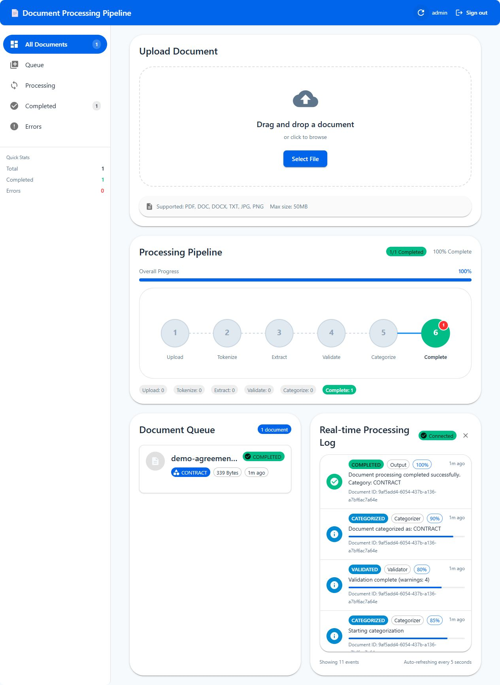

# Five-minute walkthrough

Use the included [fictional supply agreement](../examples/demo-agreement.txt). The example contains no client information.

1. Start the app using `Start Pipeline.cmd`, or follow the [manual setup](../README.md#run-locally). The dashboard opens at `http://127.0.0.1:3000`.
2. Sign in as `admin`, unless you configured `IDP_USERNAME`. For a first local launch, read the generated password from `backend/data/bootstrap-password.txt`; if you set `IDP_PASSWORD`, use that value. The launcher prints the file path without printing its contents.
3. Upload `examples/demo-agreement.txt` using **Upload Document**. The queue should show the file as `UPLOADED`; uploading alone does not start processing.
4. Choose **Start Pipeline**. The dashboard processes queued uploads in order through tokenization, extraction, validation, categorization, and completion.
5. Check that the document reaches `COMPLETED` with category `CONTRACT`. Review its extracted text and the real-time stage events. Categorization uses keyword rules; this result is a demonstration of the workflow.
6. Reload the dashboard. The completed record and extracted content remain available. Stop and restart the backend, sign in again, and confirm the record is still present: documents live in the file database; login sessions end on server restart.
7. Sign out. The document API rejects anonymous access and the active WebSocket subscription closes.

To explore validation, try uploading an unsupported `.zip` file: the API rejects it before it enters the queue. To try a binary format, use a synthetic text-containing PDF or DOCX. Scans and image-only PDFs need an external OCR setup and may not produce usable text in the default installation.

The screenshot records the local application. The project does not provide a public document-upload service. Use fictional files for portfolio demonstrations and see [storage and backups](../README.md#storage-and-backups) before changing data locations.
